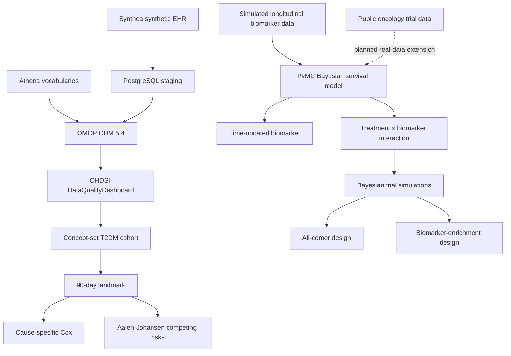
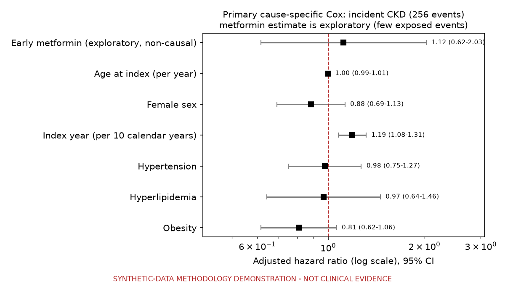
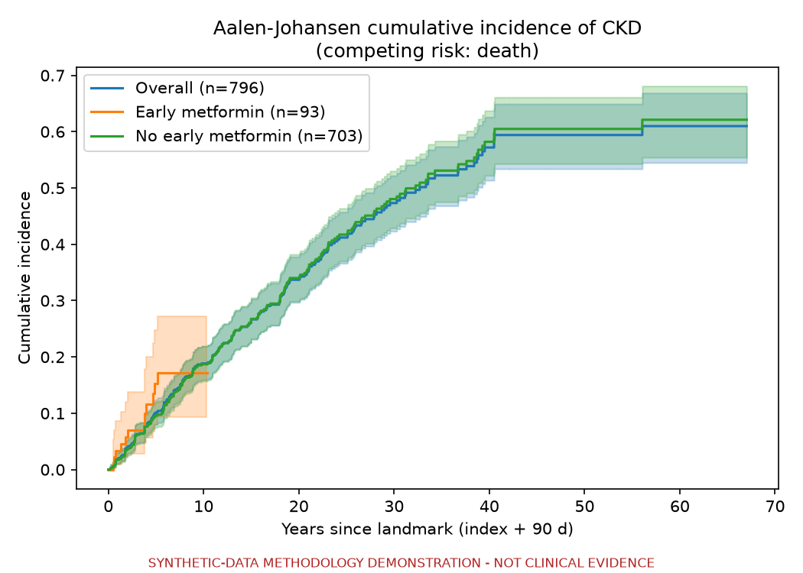
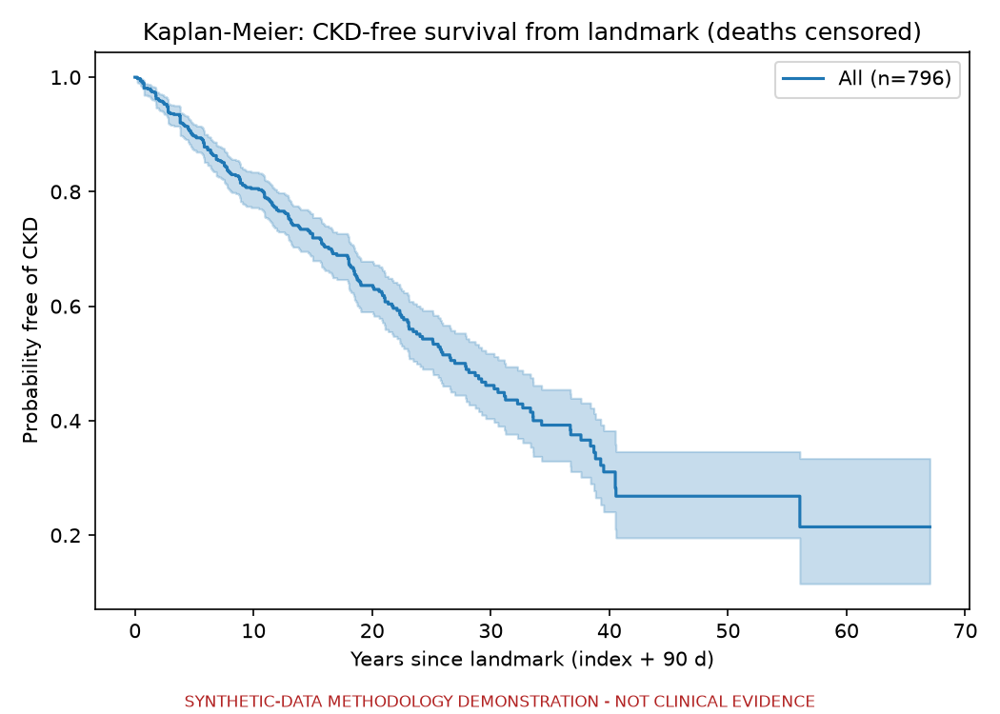
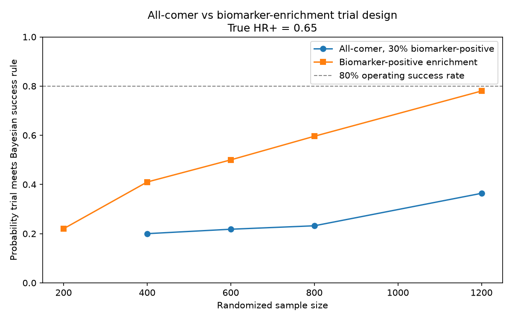

# Synthea-to-OMOP

**End-to-end OMOP CDM 5.4 pipeline, survival analysis, and Bayesian biomarker-guided trial simulation.**

This repository demonstrates two complementary clinical-data workflows:

1. **Synthea → OMOP CDM 5.4 → data quality → cohort construction → time-to-event analysis**
2. **Bayesian survival modeling → time-updated biomarkers → biomarker-stratified clinical trial simulation**

> **All currently reported analyses are methodology demonstrations.**
>
> The OMOP analysis uses synthetic Synthea data. The Bayesian model is validated using simulated data with known parameters. Prespecified trial-simulation treatment effects are illustrative scenarios, not estimated clinical effects.

This repository does **not** present clinical evidence and does **not** claim causal treatment effects.

---

## Overview



---

# Part I: Synthea to OMOP CDM 5.4

## Pipeline

| Stage | Code | Output |
|---|---|---|
| Generate Synthea, 10,000 population, seed 42 | `scripts/generate_synthea.sh` | `data/synthea/` |
| Load OMOP vocabularies | `R/01_load_vocab.R` | `cdm` schema |
| Synthea → OMOP ETL | `R/02_etl.R`, `python/align_synthea_csv.py` | `cdm`, `native` |
| Data quality | `R/03_dqd.R`, `R/04_dqd_review.R` | `output/dqd/` |
| Cohort feasibility | `sql/01_*.sql`, `sql/02_*.sql` | read-only |
| Analytic cohort | `sql/03_build_analytic_cohort.sql` | `results.t2dm_ckd_*` |
| Survival analysis | `python/analysis/survival.py` | tables and figures |

---

## Core OMOP CDM counts

| Table | Rows |
|---|---:|
| `person` | 11,468 |
| `observation_period` | 11,468 |
| `condition_occurrence` | 192,944 |
| `drug_exposure` | 752,163 |
| `measurement` | 5,762,946 |
| `visit_occurrence` | 602,551 |
| `death` | 1,375 |

---

## OHDSI DataQualityDashboard

Data quality was evaluated using DataQualityDashboard 2.9.1 against the `cdm` schema, excluding the incomplete COST domain.

**1,464 of 1,484 evaluable pass/fail checks passed (98.65%).**

Additional results:

- 20 failed checks
- 33 checks flagged by DQD with `isError=1`
- 836 checks not applicable
- 2,320 checks considered overall

A separate audit of the JSON output identified 46 records containing error messages. All occurred on the optional `COHORT` or `COHORT_DEFINITION` tables, which did not yet exist when DQD was executed.

Eighteen failed checks remain classified as `requires_review`. They include concept-completeness and plausibility findings and are not automatically treated as ETL defects.

The analysis therefore preserves the original DQD results rather than modifying synthetic data to maximize the pass rate.

### Known DQD limitation

The COST table was excluded because the local ETL query had prohibitive runtime. COST is not required by the downstream T2DM-to-CKD analysis.

---

# Part II: Landmark T2DM-to-CKD survival analysis

## Cohort definition

- Index: first T2DM condition under OMOP concept `201826` and descendants
- Landmark: index + 90 days
- Primary endpoint: first CKD under concept `46271022` and descendants
- Competing event: death before CKD
- Censoring: observation-period end
- Early metformin: exposure to ingredient `1503297` during index through day 90
- Drug quantity and dose are not used because DQD identified those fields as unreliable in this synthetic dataset

### Attrition

| Step | Remaining |
|---|---:|
| T2DM index inside observation period | 843 |
| Exclude CKD on/before landmark | 821 |
| Exclude death on/before landmark | 820 |
| Exclude observation end before landmark | **796** |

Final analytic cohort:

- **796 patients**
- **256 incident CKD events**
- **110 competing deaths**
- **430 censored**

A sensitivity endpoint including diabetic kidney disease concept `192279` produced 264 events among 791 eligible patients.

---

## Primary cause-specific Cox model

N = 796, 256 CKD events.

| Covariate | HR | 95% CI | p |
|---|---:|---:|---:|
| Early metformin, exploratory | 1.12 | 0.62–2.03 | 0.72 |
| Age, per year | 1.00 | 0.99–1.01 | 0.98 |
| Female | 0.88 | 0.69–1.13 | 0.32 |
| Index year, per 10 years | 1.19 | 1.08–1.31 | 0.0007 |
| Hypertension | 0.98 | 0.75–1.27 | 0.86 |
| Hyperlipidemia | 0.97 | 0.64–1.46 | 0.88 |
| Obesity | 0.81 | 0.62–1.06 | 0.13 |

Schoenfeld-residual testing flagged possible non-proportionality for hypertension (`p = 0.030`). The prespecified model was retained, and the finding is reported as a diagnostic limitation rather than automatically altering the model.



*Synthetic-data methodology demonstration. The metformin estimate is exploratory and non-causal.*

---

## Competing-risk analysis

Aalen-Johansen cumulative incidence estimates:

| Years | CKD | Death before CKD |
|---:|---:|---:|
| 1 | 0.019 | 0.010 |
| 5 | 0.101 | 0.027 |
| 10 | 0.188 | 0.063 |
| 20 | 0.337 | 0.139 |





These values reflect the Synthea generator and should not be interpreted as clinical incidence estimates.

---

## Exploratory metformin analysis

Early metformin exposure occurred in:

- 93 patients
- 12 CKD events

Metformin use was strongly associated with calendar era and follow-up differed between exposed and unexposed patients.

The metformin coefficient is therefore retained only as an **exploratory covariate** and is not interpreted as a treatment effect.

---

# Part III: Bayesian survival modeling

The `bayesian_trial/` module extends the project from clinical-data standardization and conventional time-to-event analysis into Bayesian inference and biomarker-guided clinical trial design.

## Bayesian piecewise-exponential survival model

Implemented in PyMC with:

- piecewise baseline hazards
- right censoring
- time-updated biomarker measurements
- treatment effect
- treatment × biomarker interaction
- Bayesian posterior inference
- prior predictive simulation
- posterior predictive checks
- MCMC convergence diagnostics

The implementation was first validated on simulated data where the generating parameters were known.

### Simulation validation

Simulation:

- 600 patients
- 327 events
- four NUTS chains
- 1,000 tuning iterations per chain
- 1,000 posterior draws per chain
- target acceptance = 0.95

Diagnostics:

- **0 divergences**
- **R-hat = 1.00**
- bulk ESS > 1,400
- tail ESS > 1,300

Parameter recovery:

| Parameter | True value | Posterior mean | 94% HDI |
|---|---:|---:|---:|
| Treatment log-HR | -0.288 | -0.342 | -0.529 to -0.117 |
| Biomarker effect | 0.300 | 0.331 | 0.174 to 0.464 |
| Treatment × biomarker | -0.250 | -0.343 | -0.541 to -0.137 |

Posterior median treatment HR was approximately **0.71**, with:

`P(HR < 1 | data) = 0.9985`

Posterior predictive validation:

- Observed events: **327**
- Posterior-predictive 90% interval: **286–369**

The observed number of events was contained within the posterior-predictive distribution.

---

# Part IV: Bayesian biomarker-guided trial simulation

The project additionally evaluates biomarker-stratified randomized OS trial designs.

These simulations use **prespecified scenarios**, not treatment effects inferred from real patient data.

## Illustrative assumptions

| Parameter | Simulation setting |
|---|---:|
| Endpoint | Overall survival |
| Allocation | 1:1 |
| Biomarker-positive prevalence | 30% |
| Control median OS | 18 months |
| Accrual | 18 months |
| Additional follow-up | 12 months |
| Annual dropout | 7% |
| Prior on log-HR | Normal(0, 1) |
| Simulation HR+ scenarios | 0.65, 0.75, 0.85, 1.00 |
| HR− scenarios | 0.90, 1.00 |

### Bayesian decision rule

Illustrative trial success:

`P(HR < 0.80 | data) >= 0.95`

Illustrative futility:

`P(HR < 0.80 | data) <= 0.20`

These thresholds are demonstration rules for simulation and are **not regulatory decision standards**.

For computational efficiency, trial operating characteristics use a normal approximation to the log-HR likelihood combined with the Bayesian prior. Individual simulated trials are not each refitted with full PyMC MCMC.

---

## All-comer versus biomarker-enrichment design



When treatment benefit was prespecified to occur primarily in the biomarker-positive subgroup (`HR+ = 0.65`, `HR− = 1.00`), enrichment substantially increased the probability that the trial met the prespecified Bayesian success rule.

This represents improved **trial operating characteristics under the simulated scenario**, not improved treatment efficacy.

---

## Enrichment operating characteristics

A refined simulation used 2,000 replicates per sample-size scenario.

| Biomarker+ randomized N | Mean OS events | Success probability | Monte Carlo 95% interval |
|---:|---:|---:|---:|
| 1,000 | 448 | 70.1% | 68.1–72.1% |
| 1,100 | 492 | 72.7% | 70.8–74.7% |
| 1,200 | 537 | 75.9% | 74.0–77.7% |
| 1,300 | 583 | 79.4% | 77.6–81.1% |
| 1,400 | 628 | 81.6% | 79.9–83.3% |
| 1,600 | 717 | 85.8% | 84.2–87.3% |

Under these assumptions, approximately **1,300–1,400 biomarker-positive randomized participants**, corresponding to roughly **580–630 OS events**, produced an approximately 80% operating success rate.

At 30% biomarker prevalence, recruiting 1,300–1,400 biomarker-positive participants would require screening at least approximately 4,300–4,700 patients before accounting for assay failures, screening failures, or withdrawals.

This illustrates the trade-off between statistical enrichment and screening burden.

---

# Planned real-oncology-data extension

Access has been requested to a public patient-level oncology clinical-trial dataset for the next stage of validation.

The planned analysis will evaluate:

- OS using real patient-level outcomes
- longitudinal biomarkers when repeated measurements are genuinely available
- Bayesian posterior uncertainty
- treatment-by-biomarker interactions where scientifically and statistically appropriate
- PFS only if progression dates/status are explicitly defined in the source data

No patient-level external oncology trial data are currently distributed with this repository.

**All currently reported Bayesian survival and trial-design results are simulation-based. No simulated association is presented as a clinical finding.**

---

# Repository structure

```text
.
├── R/
│   ├── 01_load_vocab.R
│   ├── 02_etl.R
│   ├── 03_dqd.R
│   └── 04_dqd_review.R
├── sql/
│   ├── 01_cohort_feasibility.sql
│   ├── 02_exposure_feasibility.sql
│   └── 03_build_analytic_cohort.sql
├── python/
│   ├── run_sql.py
│   └── analysis/
│       └── survival.py
├── scripts/
├── tests/
├── docs/
│   └── figures/
└── bayesian_trial/
    ├── bt_common.py
    ├── run_demo.py
    ├── trial_sim.py
    ├── plot_trial_sim.py
    ├── plot_enrichment.py
    ├── data/
    │   └── README.md
    └── output/
        ├── simulation/
        └── figures/
```

---

# Setup

## OMOP environment

```bash
cp .env.example .env
```

Set:

```text
DB_HOST
DB_PORT
DB_NAME
DB_USER
DB_PASSWORD
```

Never commit `.env`.

Requirements:

- Java for Synthea
- PostgreSQL
- R with OHDSI packages
- Python 3
- OMOP vocabularies downloaded separately from Athena

Run:

```bash
make synthea
make vocab
make etl
make dqd
make cohort
make survival
```

or:

```bash
make analysis
```

## Bayesian environment

Example:

```bash
mamba create -n bayes -c conda-forge \
  python=3.11 pymc arviz pandas numpy scipy matplotlib -y

conda activate bayes
cd bayesian_trial
```

Validate the Bayesian model:

```bash
python run_demo.py
```

Run trial-design simulations:

```bash
python trial_sim.py
```

---

# Testing

```bash
make test
```

Tests cover:

- credential handling
- SQL statement parsing
- one-row-per-person analytic datasets
- valid event coding
- nonnegative follow-up
- required analysis outputs

---

# Limitations

- **Synthetic OMOP data:** Synthea-derived associations do not represent clinical evidence.
- **Synthetic Bayesian validation:** Bayesian parameter-recovery and trial-design results currently use simulated data.
- **Prespecified treatment effects:** HR scenarios used in trial simulation are hypothetical inputs, not estimated clinical effects.
- **Calendar-time confounding:** the Synthea T2DM cohort spans 1947–2026.
- **Sparse metformin events:** only 12 CKD events occurred among 93 early-metformin-exposed patients.
- **Incomplete COST domain:** COST was excluded from downstream analysis and DQD.
- **Phenotype representation:** Synthea coding does not necessarily reproduce real-world disease phenotypes.
- **Trial-design assumptions:** operating characteristics depend on assumed control survival, prevalence, treatment effect, accrual, dropout, follow-up, prior, and posterior decision rule.
- **Normal approximation in repeated trial simulations:** operating-characteristic simulations use an approximate Bayesian log-HR posterior rather than full MCMC for every simulated trial.
- **Real oncology validation pending:** patient-level public oncology trial data have not yet been incorporated.
- **PFS not currently analyzed:** PFS will only be implemented if progression endpoints are explicitly available and auditable in the external source data.

---

# Intended use

This repository is a technical portfolio demonstrating:

- OMOP CDM 5.4
- OHDSI tooling
- clinical-data ETL and quality assessment
- clinical phenotype and concept-set construction
- landmark survival analysis
- competing risks
- Bayesian survival inference
- longitudinal/time-updated biomarkers
- posterior predictive validation
- biomarker-stratified clinical trial simulation
- trial operating-characteristic evaluation
- reproducible clinical data-science workflows
